# OpenGameArt: 2D art

**81 assets from [OpenGameArt](https://opengameart.org), dedicated to the public domain under [CC0](https://creativecommons.org/publicdomain/zero/1.0/).** Use them in any game, free or paid, and change them however you like; no credit is needed.

2D art from OpenGameArt entries licensed CC0 (some also offer other licences; CC0 is the one that applies here). 561.4 MB in all.

This is a copy kept by [zuujis-cc0](https://github.com/zuujis-cc0) so game makers can take single files from GitHub. It is not made by or affiliated with OpenGameArt: the originals, often in more formats and higher resolutions, are on [opengameart.org](https://opengameart.org). If they help you, consider [supporting OpenGameArt](https://opengameart.org/content/faq).

Every file is listed in [MANIFEST.tsv](MANIFEST.tsv) with its size and SHA-256. More free assets: [the Zuujis collection](https://github.com/zuujis-cc0/free-game-assets#readme).

| | | | |
| :-: | :-: | :-: | :-: |
| <a href="spinning-coin-sprites">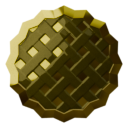</a> <b><a href="spinning-coin-sprites">spinning coin sprites</a></b> by KillGorack · <a href="https://opengameart.org/content/spinning-coin-sprites">source</a> | <a href="spinning-glass-potions">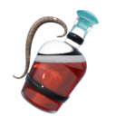</a> <b><a href="spinning-glass-potions">Spinning glass potions</a></b> by KillGorack · <a href="https://opengameart.org/content/spinning-glass-potions">source</a> |  <b><a href="spinning-key">Spinning key</a></b> by KillGorack · <a href="https://opengameart.org/content/spinning-key">source</a> |  <b><a href="spirit-essence">Spirit Essence</a></b> by Soloslime · <a href="https://opengameart.org/content/spirit-essence">source</a> |
| <a href="spooky-9-slice-window">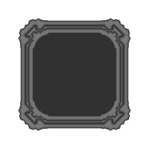</a> <b><a href="spooky-9-slice-window">Spooky 9-slice window</a></b> by Tisroc · <a href="https://opengameart.org/content/spooky-9-slice-window">source</a> | <a href="spooky-cursors-pack">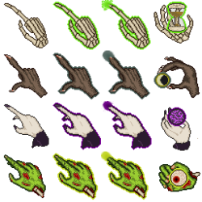</a> <b><a href="spooky-cursors-pack">Spooky cursors pack</a></b> by Tisroc · <a href="https://opengameart.org/content/spooky-cursors-pack">source</a> | <a href="spoopy-tiles">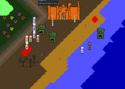</a> <b><a href="spoopy-tiles">Spoopy Tiles</a></b> by Some Weirdo · <a href="https://opengameart.org/content/spoopy-tiles">source</a> | <a href="sports-cars-pixelart-sprites">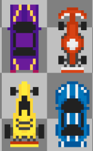</a> <b><a href="sports-cars-pixelart-sprites">Sports cars pixelart sprites</a></b> by wender · <a href="https://opengameart.org/content/sports-cars-pixelart-sprites">source</a> |
| <a href="spring-monster-pack">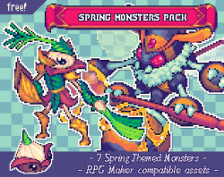</a> <b><a href="spring-monster-pack">Spring Monster Pack</a></b> by tiopalada · <a href="https://opengameart.org/content/spring-monster-pack">source</a> | <a href="spring-vfx-pack">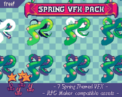</a> <b><a href="spring-vfx-pack">Spring VFX Pack</a></b> by tiopalada · <a href="https://opengameart.org/content/spring-vfx-pack">source</a> | <a href="stalagmite-monster">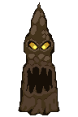</a> <b><a href="stalagmite-monster">Stalagmite Monster</a></b> by Some Weirdo · <a href="https://opengameart.org/content/stalagmite-monster">source</a> | <a href="standard-tile-maps">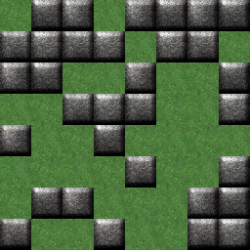</a> <b><a href="standard-tile-maps">Standard tile maps</a></b> by KillGorack · <a href="https://opengameart.org/content/standard-tile-maps">source</a> |
|  <b><a href="star-scape-background">Star Scape Background</a></b> by curato · <a href="https://opengameart.org/content/star-scape-background">source</a> | <a href="steampunk-cyber-dungeon-tiles">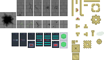</a> <b><a href="steampunk-cyber-dungeon-tiles">Steampunk cyber dungeon tiles</a></b> by ChikenwingJJA · <a href="https://opengameart.org/content/steampunk-cyber-dungeon-tiles">source</a> |  <b><a href="steel-golem-walking">Steel Golem Walking</a></b> by DanyOctrome · <a href="https://opengameart.org/content/steel-golem-walking">source</a> |  <b><a href="store-button-shop-button-icon">Store button (Shop button icon)</a></b> by ElSantoTiago · <a href="https://opengameart.org/content/store-button-shop-button-icon">source</a> |
| <a href="straw-wizard-hat-16x16">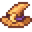</a> <b><a href="straw-wizard-hat-16x16">Straw Wizard Hat 16x16</a></b> by simranzenov · <a href="https://opengameart.org/content/straw-wizard-hat-16x16">source</a> | <a href="sunbursts-2d-rays">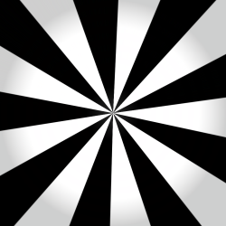</a> <b><a href="sunbursts-2d-rays">Sunbursts / 2D Rays</a></b> by simranzenov · <a href="https://opengameart.org/content/sunbursts-2d-rays">source</a> | <a href="super-cool-robot">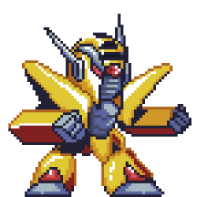</a> <b><a href="super-cool-robot">Super Cool Robot</a></b> by Diogenes99 · <a href="https://opengameart.org/content/super-cool-robot">source</a> | <a href="super-random-penguin-edit">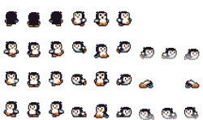</a> <b><a href="super-random-penguin-edit">Super Random Penguin Edit</a></b> by Zombie Rat · <a href="https://opengameart.org/content/super-random-penguin-edit">source</a> |
| <a href="surts-abyssal-tree">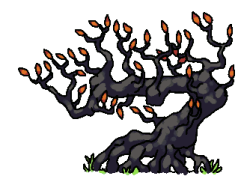</a> <b><a href="surts-abyssal-tree">surt's abyssal tree</a></b> by Emcee Flesher · <a href="https://opengameart.org/content/surts-abyssal-tree">source</a> | <a href="survivor-portraits-post-apocalyptic-survival">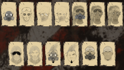</a> <b><a href="survivor-portraits-post-apocalyptic-survival">Survivor Portraits (Post-Apocalyptic Survival)</a></b> by Gendgi · <a href="https://opengameart.org/content/survivor-portraits-post-apocalyptic-survival">source</a> |  <b><a href="sword-pack-2d">Sword Pack (2d)</a></b> by Lyricsz · <a href="https://opengameart.org/content/sword-pack-2d">source</a> |  <b><a href="sword-warrior-monster">sword warrior monster</a></b> by woodsmoke · <a href="https://opengameart.org/content/sword-warrior-monster">source</a> |
| <a href="tcg-templates">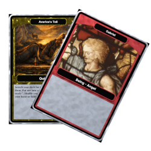</a> <b><a href="tcg-templates">TCG Templates</a></b> by KillGorack · <a href="https://opengameart.org/content/tcg-templates">source</a> | <a href="tech-base-modules">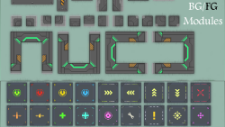</a> <b><a href="tech-base-modules">Tech Base Modules</a></b> by Reactorcore · <a href="https://opengameart.org/content/tech-base-modules">source</a> | <a href="teleporter-tile">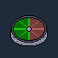</a> <b><a href="teleporter-tile">Teleporter Tile</a></b> by NoahTheNerd · <a href="https://opengameart.org/content/teleporter-tile">source</a> | <a href="test-tube-chemical-pixel-art">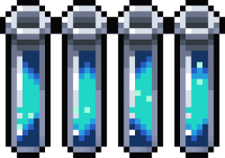</a> <b><a href="test-tube-chemical-pixel-art">test tube chemical pixel art</a></b> by ElectDraw · <a href="https://opengameart.org/content/test-tube-chemical-pixel-art">source</a> |
| <a href="test-tube-item">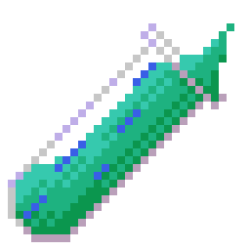</a> <b><a href="test-tube-item">Test tube item</a></b> by Pixel Representation · <a href="https://opengameart.org/content/test-tube-item">source</a> | <a href="texture-grid-pack">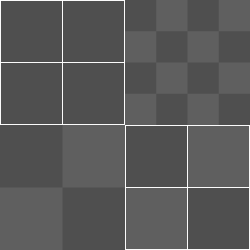</a> <b><a href="texture-grid-pack">Texture Grid Pack</a></b> by Screaming Brain Studios · <a href="https://opengameart.org/content/texture-grid-pack">source</a> | <a href="the-cave-of-pillars">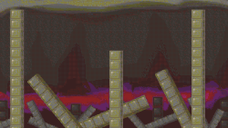</a> <b><a href="the-cave-of-pillars">The Cave of Pillars</a></b> by Spring Spring · <a href="https://opengameart.org/content/the-cave-of-pillars">source</a> | <a href="the-guard">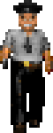</a> <b><a href="the-guard">The Guard</a></b> by knekko · <a href="https://opengameart.org/content/the-guard">source</a> |
| <a href="the-major-guy">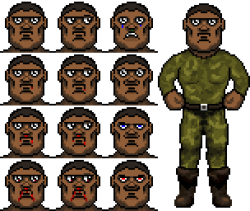</a> <b><a href="the-major-guy">The Major Guy</a></b> by knekko · <a href="https://opengameart.org/content/the-major-guy">source</a> |  <b><a href="the-man-0">The man</a></b> by mavi robo · <a href="https://opengameart.org/content/the-man-0">source</a> | <a href="tileable-backgrounds-blurred-variants">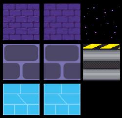</a> <b><a href="tileable-backgrounds-blurred-variants">Tileable Backgrounds + Blurred Variants</a></b> by Supergamezzz · <a href="https://opengameart.org/content/tileable-backgrounds-blurred-variants">source</a> | <a href="tileset-templates">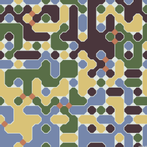</a> <b><a href="tileset-templates">Tileset Templates</a></b> by Wisp0468 · <a href="https://opengameart.org/content/tileset-templates">source</a> |
| <a href="tilesets-and-background-alien-planet">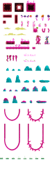</a> <b><a href="tilesets-and-background-alien-planet">Tilesets and Background Alien Planet</a></b> by Gendgi · <a href="https://opengameart.org/content/tilesets-and-background-alien-planet">source</a> | <a href="tilesets-base-rpg-2d">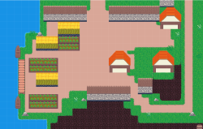</a> <b><a href="tilesets-base-rpg-2d">Tilesets Base RPG 2D</a></b> by nqxo · <a href="https://opengameart.org/content/tilesets-base-rpg-2d">source</a> | <a href="tiny-rpg-dark-dwellers-gui">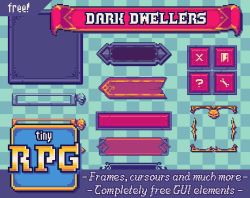</a> <b><a href="tiny-rpg-dark-dwellers-gui">Tiny RPG - Dark Dwellers GUI</a></b> by tiopalada · <a href="https://opengameart.org/content/tiny-rpg-dark-dwellers-gui">source</a> | <a href="tiny-rpg-emoji-pack-i">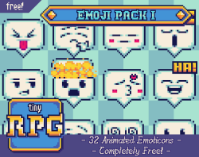</a> <b><a href="tiny-rpg-emoji-pack-i">Tiny RPG - Emoji Pack I</a></b> by tiopalada · <a href="https://opengameart.org/content/tiny-rpg-emoji-pack-i">source</a> |
| <a href="tiny-rpg-font-kit-ii">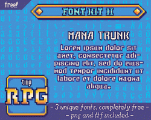</a> <b><a href="tiny-rpg-font-kit-ii">Tiny RPG - Font Kit II</a></b> by tiopalada · <a href="https://opengameart.org/content/tiny-rpg-font-kit-ii">source</a> | <a href="tiny-rpg-font-kit-iii">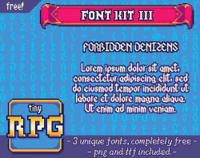</a> <b><a href="tiny-rpg-font-kit-iii">Tiny RPG - Font Kit III</a></b> by tiopalada · <a href="https://opengameart.org/content/tiny-rpg-font-kit-iii">source</a> | <a href="tiny-rpg-mana-soul-gui">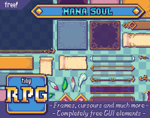</a> <b><a href="tiny-rpg-mana-soul-gui">Tiny RPG - Mana Soul GUI</a></b> by tiopalada · <a href="https://opengameart.org/content/tiny-rpg-mana-soul-gui">source</a> | <a href="top-down-sports-car-sprite">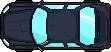</a> <b><a href="top-down-sports-car-sprite">Top-down sports car sprite</a></b> by knekko · <a href="https://opengameart.org/content/top-down-sports-car-sprite">source</a> |
|  <b><a href="tower-defense-slime-enemy">Tower defense slime enemy</a></b> by Tisroc · <a href="https://opengameart.org/content/tower-defense-slime-enemy">source</a> | <a href="town-guards-vol1-%E2%80%94-6-characters-complete-sample-64px">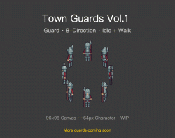</a> <b><a href="town-guards-vol1-%E2%80%94-6-characters-complete-sample-64px">Town Guards Vol.1 — 6 Characters (Complete Sample, ~64px)</a></b> by hnnnnnnn · <a href="https://opengameart.org/content/town-guards-vol1-%E2%80%94-6-characters-complete-sample-64px">source</a> | <a href="tread-animation">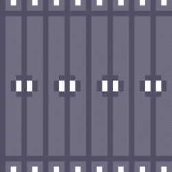</a> <b><a href="tread-animation">Tread animation</a></b> by Pixel Representation · <a href="https://opengameart.org/content/tread-animation">source</a> | <a href="tree-in-pixel-art">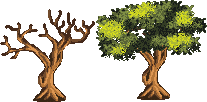</a> <b><a href="tree-in-pixel-art">Tree! in pixel art</a></b> by ElectDraw · <a href="https://opengameart.org/content/tree-in-pixel-art">source</a> |
|  <b><a href="tsunami-animation">Tsunami animation</a></b> by mkwong98 · <a href="https://opengameart.org/content/tsunami-animation">source</a> |  <b><a href="turtle-21-pixels">Turtle (2:1 pixels)</a></b> by bruhfrom2012 · <a href="https://opengameart.org/content/turtle-21-pixels">source</a> | <a href="ui-graphics">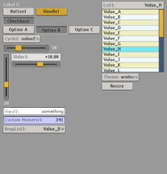</a> <b><a href="ui-graphics">ui graphics</a></b> by doushite · <a href="https://opengameart.org/content/ui-graphics">source</a> | <a href="ultimate-potions-pack-2d">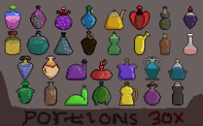</a> <b><a href="ultimate-potions-pack-2d">Ultimate Potions Pack - 2D</a></b> by Lyricsz · <a href="https://opengameart.org/content/ultimate-potions-pack-2d">source</a> |
| <a href="unfinished-gun-sprites-in-gif-format">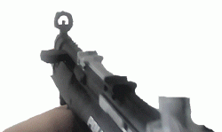</a> <b><a href="unfinished-gun-sprites-in-gif-format">Unfinished gun sprites in gif format</a></b> by rotman5 · <a href="https://opengameart.org/content/unfinished-gun-sprites-in-gif-format">source</a> |  <b><a href="unidentified-flying-objectufo">Unidentified Flying Object/UFO</a></b> by bruhfrom2012 · <a href="https://opengameart.org/content/unidentified-flying-objectufo">source</a> | <a href="universal-16x16-tileset">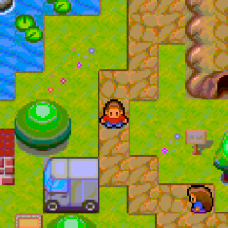</a> <b><a href="universal-16x16-tileset">Universal 16x16 Tileset</a></b> by Drummyfish · <a href="https://opengameart.org/content/universal-16x16-tileset">source</a> | <a href="universal-8x8-tileset">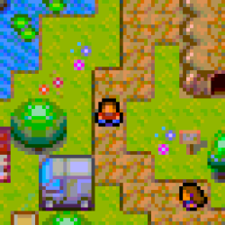</a> <b><a href="universal-8x8-tileset">Universal 8x8 Tileset</a></b> by Drummyfish · <a href="https://opengameart.org/content/universal-8x8-tileset">source</a> |
| <a href="urban-tiles">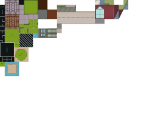</a> <b><a href="urban-tiles">Urban Tiles</a></b> by Some Weirdo · <a href="https://opengameart.org/content/urban-tiles">source</a> | <a href="valley-city-topographic-map">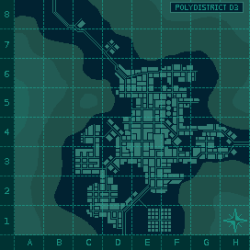</a> <b><a href="valley-city-topographic-map">Valley City Topographic Map</a></b> by knekko · <a href="https://opengameart.org/content/valley-city-topographic-map">source</a> |  <b><a href="vampire-hand-cursor">Vampire hand cursor</a></b> by Tisroc · <a href="https://opengameart.org/content/vampire-hand-cursor">source</a> | <a href="vampyr">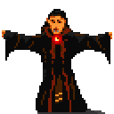</a> <b><a href="vampyr">Vampyr</a></b> by knekko · <a href="https://opengameart.org/content/vampyr">source</a> |
| <a href="vaquita-porpoise-202511">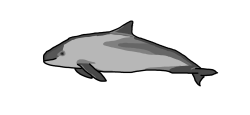</a> <b><a href="vaquita-porpoise-202511">Vaquita Porpoise 2025.11</a></b> by WilliamVincent-Killian · <a href="https://opengameart.org/content/vaquita-porpoise-202511">source</a> | <a href="various-pixel-fonts">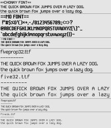</a> <b><a href="various-pixel-fonts">various pixel fonts</a></b> by doushite · <a href="https://opengameart.org/content/various-pixel-fonts">source</a> | <a href="vcr">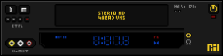</a> <b><a href="vcr">VCR</a></b> by knekko · <a href="https://opengameart.org/content/vcr">source</a> |  <b><a href="vector-clouds">Vector Clouds</a></b> by Modanung · <a href="https://opengameart.org/content/vector-clouds">source</a> |
|  <b><a href="vector-heart">Vector Heart</a></b> by UrieW · <a href="https://opengameart.org/content/vector-heart">source</a> |  <b><a href="vtol-military-vigilante-turbojet-fighter-plane">VTOL Military Vigilante Turbojet Fighter Plane</a></b> by Reactorcore · <a href="https://opengameart.org/content/vtol-military-vigilante-turbojet-fighter-plane">source</a> |  <b><a href="wang-tiles-collection">Wang tiles collection</a></b> by Croomfolk · <a href="https://opengameart.org/content/wang-tiles-collection">source</a> |  <b><a href="water-aqua-layer-system">Water Aqua Layer System</a></b> by Reactorcore · <a href="https://opengameart.org/content/water-aqua-layer-system">source</a> |
|  <b><a href="watercolor-medieval-city-map">Watercolor Medieval City Map</a></b> by PamNawi · <a href="https://opengameart.org/content/watercolor-medieval-city-map">source</a> |  <b><a href="waterfall-0">WaterFall</a></b> by ElectDraw · <a href="https://opengameart.org/content/waterfall-0">source</a> |  <b><a href="wheel-fortune">Wheel Fortune</a></b> by draganasgamesart · <a href="https://opengameart.org/content/wheel-fortune">source</a> |  <b><a href="windows-frames">windows frames</a></b> by Tilt2D · <a href="https://opengameart.org/content/windows-frames">source</a> |
|  <b><a href="wip-super-prop-pack">(WIP) SUPER PROP PACK</a></b> by ChikenwingJJA · <a href="https://opengameart.org/content/wip-super-prop-pack">source</a> |  <b><a href="woman-face">Woman face</a></b> by lucius39 · <a href="https://opengameart.org/content/woman-face">source</a> |  <b><a href="wooden-crates">Wooden Crates</a></b> by BunnyX · <a href="https://opengameart.org/content/wooden-crates">source</a> |  <b><a href="wooden-floor-asset">Wooden Floor Asset</a></b> by Pixel Representation · <a href="https://opengameart.org/content/wooden-floor-asset">source</a> |
|  <b><a href="wooden-stock-russian-guns">Wooden Stock Russian guns</a></b> by Ruhl34 · <a href="https://opengameart.org/content/wooden-stock-russian-guns">source</a> |  <b><a href="wplace-63-palette-mini-pixel-pack-cc0">Wplace 63 Palette + Mini Pixel Pack (CC0)</a></b> by howardFree · <a href="https://opengameart.org/content/wplace-63-palette-mini-pixel-pack-cc0">source</a> |  <b><a href="x48-retro-browser-window">x48 Retro Browser Window</a></b> by GodOfAnthrax · <a href="https://opengameart.org/content/x48-retro-browser-window">source</a> |  <b><a href="xenia-the-linux-fox-sprites">Xenia the Linux Fox sprites</a></b> by Cawfeecrow · <a href="https://opengameart.org/content/xenia-the-linux-fox-sprites">source</a> |
|  <b><a href="yellow-spring">Yellow spring</a></b> by MrOnion · <a href="https://opengameart.org/content/yellow-spring">source</a> |  |  |  |

---

Kept up to date by this repository's own [update workflow](.github/workflows/update.yml), with code and plan from [cc0-mirror](https://github.com/zuujis-cc0/cc0-mirror). Something wrong? [Open an issue there](https://github.com/zuujis-cc0/cc0-mirror/issues/new) or use the [private report form](https://games.zuujis.com/report).
